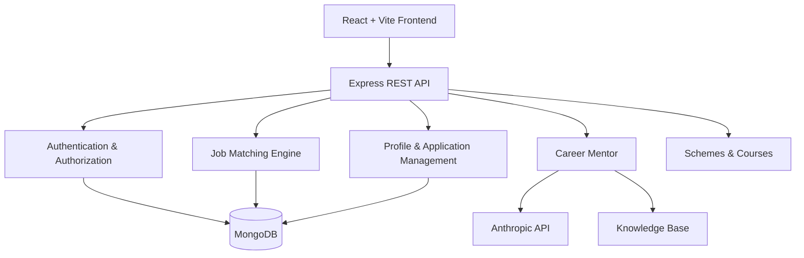

# Karya Siri – AI-Driven Inclusive Job Accessibility Platform

**Connecting Persons with Disabilities to Meaningful Employment Opportunities.**

Karya Siri is a MERN-stack-based inclusive job-matching platform designed to improve employment accessibility for persons with disabilities (Divyangjan). It connects candidates with suitable job opportunities across multiple industries based on their skills, interests, qualifications, resume information, and accessibility requirements.

The platform combines accessibility-aware job recommendations, an AI-powered Career Mentor, government welfare scheme discovery, and skill-development resources to support candidates throughout their employment journey.

It also provides screen-reader-friendly navigation, voice interaction, speech-to-text, text-to-speech, and multilingual support to make the platform accessible to blind and low-vision users.

---

## Key Features

- **Inclusive Job Matching:** Matches candidates with suitable opportunities based on skills, interests, qualifications, resume information, and accessibility requirements.
- **Accessibility-Aware Recommendations:** Considers disability-specific accommodation requirements, including screen-reader compatibility and remote work.
- **AI Career Mentor:** Provides personalized career guidance, course recommendations, profile assistance, and government scheme information.
- **UDID-Based Eligibility Support:** Supports disability-related eligibility and verification workflows.
- **Government Schemes Hub:** Provides information and official links to government schemes for persons with disabilities.
- **Skill Development:** Integrates free and low-cost courses from government and recognized learning platforms.
- **Multilingual Interface:** Supports English, Hindi, Tamil, Telugu, Bengali, and Marathi.
- **Voice Accessibility:** Includes speech recognition, text-to-speech, voice navigation, and read-aloud functionality.
- **Candidate and Employer Portals:** Supports candidate registration, job applications, employer registration, and job posting.

## Technology Stack

| Layer | Technologies |
|---|---|
| Frontend | React.js, Vite, Tailwind CSS |
| Backend | Node.js, Express.js |
| Database | MongoDB, Mongoose |
| Authentication | JWT, bcrypt |
| AI Integration | Anthropic API (Career Mentor) |
| Frontend Visualization | Recharts |
| Accessibility | Web Speech API, SpeechRecognition, SpeechSynthesis |
| Internationalization | React-based static translation dictionary |
| Development Tools | Git, GitHub, Postman, VS Code |

## System Architecture

Karya Siri follows a client-server architecture using the MERN stack.



### Project Structure

```text
karyasiri/
│
├── server/
│   ├── data/
│   │   └── knowledge.js
│   ├── models/
│   ├── routes/
│   │   ├── auth.js
│   │   ├── profile.js
│   │   ├── jobs.js
│   │   ├── applications.js
│   │   └── mentor.js
│   ├── utils/
│   │   └── matching.js
│   ├── .env.example
│   ├── server.js
│   └── package.json
│
├── client/
│   ├── src/
│   │   ├── components/
│   │   ├── pages/
│   │   ├── context/
│   │   ├── i18n/
│   │   │   └── translations.js
│   │   └── styles/
│   ├── .env.example
│   └── package.json
│
└── README.md
```

*The directory structure above represents the main application components. Refer to the repository for the complete implementation.*

---

## Prerequisites

Ensure the following software is installed:

- Node.js 18 or later
- npm
- MongoDB (local installation or MongoDB Atlas)
- Git

**Database:** You can use either a local MongoDB instance or a free MongoDB Atlas cluster.

MongoDB Atlas: https://www.mongodb.com/atlas

---

## Installation and Setup

### 1. Clone the Repository

```bash
git clone <YOUR_REPOSITORY_URL>
cd karyasiri
```

### 2. Backend Setup

Navigate to the server directory:

```bash
cd server
```

Create the environment configuration file:

```bash
cp .env.example .env
```

Configure the required environment variables in `server/.env`:

```env
PORT=5000
MONGO_URI=mongodb://127.0.0.1:27017/karyasiri
JWT_SECRET=your_secure_jwt_secret
CLIENT_URL=http://localhost:5173

# Career Mentor Configuration
ANTHROPIC_API_KEY=your_anthropic_api_key
ANTHROPIC_MODEL=your_supported_model
```

Install dependencies:

```bash
npm install
```

Seed the database with sample job listings:

```bash
npm run seed
```

Start the development server:

```bash
npm run dev
```

Alternatively, start the server using:

```bash
npm start
```

The backend API will be available at:

`http://localhost:5000`

**Health Check:**

```http
GET http://localhost:5000/api/health
```

### 3. Frontend Setup

Open a new terminal and navigate to the client directory:

```bash
cd client
```

Create the environment configuration file:

```bash
cp .env.example .env
```

Configure the API URL:

```env
VITE_API_URL=http://localhost:5000/api
```

Install dependencies:

```bash
npm install
```

Start the frontend development server:

```bash
npm run dev
```

Open the application in your browser:

`http://localhost:5173`

---

## API Documentation

The backend exposes RESTful APIs for authentication, candidate profiles, job management, applications, and career assistance.

### Authentication APIs

| Method | Endpoint | Description |
|---|---|---|
| POST | `/api/auth/register` | Register a candidate or employer |
| POST | `/api/auth/login` | Authenticate and receive JWT |
| GET | `/api/auth/me` | Retrieve authenticated user details |

### Candidate Profile APIs

| Method | Endpoint | Description |
|---|---|---|
| GET | `/api/profile` | Retrieve candidate profile |
| PUT | `/api/profile` | Create or update candidate profile |
| POST | `/api/profile/complete-course` | Mark a course as completed and update profile skills |

### Job APIs

| Method | Endpoint | Description |
|---|---|---|
| GET | `/api/jobs` | Retrieve available jobs |
| GET | `/api/jobs?category=IT` | Filter jobs by category |
| GET | `/api/jobs/matches` | Retrieve personalized job matches |
| GET | `/api/jobs/:id` | Retrieve job details |
| POST | `/api/jobs` | Post a job (Employer) |
| GET | `/api/jobs/employer/mine` | Retrieve jobs posted by an employer |

### Application APIs

| Method | Endpoint | Description |
|---|---|---|
| POST | `/api/applications` | Apply for a job |
| GET | `/api/applications/me` | Retrieve candidate applications |
| GET | `/api/applications/job/:jobId` | Retrieve applicants for an employer's job |

### Career Mentor API

| Method | Endpoint | Description |
|---|---|---|
| POST | `/api/mentor/chat` | Interact with the AI Career Mentor |

**Authentication:** Protected endpoints require a valid JWT Bearer token. The Career Mentor supports optional authentication and provides personalized guidance when a candidate is logged in.

---

## How Job Matching Works

The job recommendation engine is implemented in:

`server/utils/matching.js`

Karya Siri uses a transparent, rule-based keyword matching algorithm to identify suitable employment opportunities for candidates.

### Matching Process

1. **Candidate Information Extraction:** Collects skills, interests, qualifications, and resume text from the candidate profile.
2. **Job Requirement Extraction:** Processes required skills and job descriptions from available job listings.
3. **Keyword Comparison:** Tokenizes and compares candidate information with job requirements to identify overlapping skills and relevant keywords.
4. **Accessibility Compatibility:** Evaluates whether the job's stated accommodations align with the candidate's accessibility requirements.
5. **Match Score Calculation:** Generates a score between 0 and 100 for each job.
6. **Job Ranking:** Sorts job opportunities based on their calculated match scores.

### Accessibility-Aware Matching

The recommendation engine considers disability-specific accommodation requirements.

For example:

- Blind or low-vision candidates can receive preference for jobs tagged with screen-reader compatibility.
- Remote opportunities can improve accessibility compatibility for candidates who require flexible working arrangements.
- Candidate skills and qualifications help identify relevant opportunities across different industries.

The resulting match score is displayed through a radial match indicator in the frontend.

**Note:** The current implementation uses a deterministic, transparent matching algorithm rather than a trained machine-learning ranking model. This allows the recommendation logic to remain interpretable and provides scope for future enhancements using embeddings and advanced resume-parsing techniques.

---

## AI-Powered Career Mentor

Karya Siri includes an integrated AI Career Mentor, accessible through a floating chat widget available across application pages.

The mentor helps candidates make informed decisions about employment, education, and government support.

### Capabilities

- Recommends suitable government schemes based on candidate requirements.
- Suggests skill-development courses.
- Provides guidance on completing candidate profiles.
- Assists with job applications.
- Offers personalized career guidance.
- Answers employment-related questions.

### Technical Implementation

**Backend:** `server/routes/mentor.js`

**Knowledge Base:** `server/data/knowledge.js`

The Career Mentor uses the Anthropic API for generating conversational responses.

Its knowledge base contains curated information about government schemes and skill-development courses available on the platform. It also retrieves a sample of currently available jobs from MongoDB to provide relevant employment suggestions.

When a candidate is authenticated, their profile information, including skills, disability-related requirements, and completed courses, is incorporated into the mentor's context to generate personalized responses.

For unauthenticated users, the mentor provides general career guidance.

### Accessibility and Error Handling

- Speech-to-text through the microphone button.
- Text-to-speech through the read-aloud functionality.
- Responses in the currently selected interface language.
- Graceful handling of missing API keys, invalid credentials, rate limits, network failures, and API outages.
- User-friendly error messages with retry functionality.

### API Configuration

Obtain an API key from:

https://console.anthropic.com/

Configure `ANTHROPIC_API_KEY` in `server/.env`.

The API key is stored and used on the backend and is never exposed directly to the browser.

An API key is required for live AI-generated responses. Without it, the application displays a configuration message instead of crashing.

---

## Government Schemes and Skill Development

### 1. Government Schemes Hub

The `/schemes` page provides information about government initiatives and welfare schemes supporting persons with disabilities.

The platform includes information about:

- ADIP Scheme
- NHFDC Loans
- Unique Disability ID (UDID)
- PM-DAKSH
- Deendayal Disabled Rehabilitation Scheme (DDRS)
- Sugamya Bharat Abhiyan
- National Career Service (NCS-PwD) Portal

Each scheme provides relevant information and links to its official government website.

### 2. Skill Development Courses

The `/courses` page provides access to free and affordable skill-development opportunities from government and recognized learning platforms.

Supported learning providers include:

- NIELIT
- PMKVY / Skill India
- SWAYAM
- NCFE
- NIOS
- NSDC

Courses cover multiple skill areas, including:

- Computer literacy and digital skills
- Cooking and tailoring
- Retail and customer service
- Spoken English
- Electronics and technical skills

### Course Completion Integration

Authenticated candidates can mark courses as completed.

The application uses:

`POST /api/profile/complete-course`

Upon completion:

1. The course completion is recorded in the candidate profile.
2. Relevant skill tags associated with the course are added to the candidate's skills.
3. The updated skills become available to the job-matching engine.
4. Newly acquired skills can improve the candidate's compatibility with relevant job opportunities.

This connects skill development directly with employment recommendations.

---

## Multilingual Support

Karya Siri provides a multilingual interface supporting six languages:

| Language | Support |
|---|---|
| English | ✓ |
| Hindi | ✓ |
| Tamil | ✓ |
| Telugu | ✓ |
| Bengali | ✓ |
| Marathi | ✓ |

Users can switch languages using the language selector in the accessibility bar.

Translations are maintained in:

`client/src/i18n/translations.js`

The application uses a static translation dictionary for the supported interface components, including navigation, hero sections, instructions, footer content, schemes, and courses.

This approach allows the translated interface to work without requiring an external translation API for every request.

---

## Accessibility Features

Accessibility is a core design consideration throughout Karya Siri.

The platform incorporates features to support users with different accessibility requirements, particularly blind and low-vision candidates.

### 1. Screen Reader Support

- Semantic HTML elements.
- Accessible labels for form fields and interactive controls.
- Skip-to-content navigation.
- Visible keyboard focus indicators.
- ARIA live announcements for important application actions.

### 2. Voice Navigation

A voice-navigation feature enables users to navigate application pages using spoken commands.

Examples:

- "Go to jobs"
- "Go to profile"

### 3. Speech-to-Text

Microphone buttons are available alongside supported text fields, including:

- Skills
- Interests
- Qualifications
- Resume information
- Cover messages

Candidates can dictate information instead of typing it manually.

### 4. Text-to-Speech

Read-aloud functionality is available for:

- Entire page content.
- Individual job cards.
- Job descriptions.
- Career Mentor responses.

### 5. Visual Accessibility

The fixed accessibility bar provides:

- Text size controls (A− / A / A+).
- High-contrast theme toggle.
- Read-page-aloud functionality.
- Voice-navigation support.

### Browser Compatibility

Voice-based features use browser-supported Web Speech APIs.

Speech recognition and speech synthesis are best supported in Chromium-based browsers such as Google Chrome and Microsoft Edge. Microphone permission is required for speech recognition.

Other accessibility features are designed to work across modern browsers.

---

## Design System

Karya Siri follows a modern, accessible visual design inspired by Indian cultural colors and inclusive design principles.

### Design Elements

- **Typography:** Outfit for headings and Inter for body text.
- **Primary Accent:** Saffron (`#FE6B00`).
- **Secondary Accent:** Forest Green (`#008166`).
- **UI Components:** Rounded cards, pill-shaped badges, and soft shadows.
- **Accessibility:** Clear visual hierarchy, readable typography, and visible interaction states.

The design system uses CSS custom properties maintained in:

`client/src/styles/index.css`

This allows consistent styling and centralized theme customization throughout the application.

---

## Environment Variables

The following table summarizes the main configuration variables.

| Variable | Location | Purpose |
|---|---|---|
| `PORT` | Server | Backend server port |
| `MONGO_URI` | Server | MongoDB connection string |
| `JWT_SECRET` | Server | JWT signing secret |
| `CLIENT_URL` | Server | Frontend application URL |
| `ANTHROPIC_API_KEY` | Server | Anthropic API authentication |
| `ANTHROPIC_MODEL` | Server | Anthropic model configuration |
| `VITE_API_URL` | Client | Backend API base URL |

Refer to the respective `.env.example` files for the exact variables required by your repository.

**Important:** Never commit `.env` files, API keys, database credentials, JWT secrets, or other sensitive configuration details to GitHub.

---

## Security Considerations

The application incorporates the following security mechanisms:

- Password hashing using bcrypt.
- JWT-based authentication.
- Role-based access for candidates and employers.
- Server-side authentication for protected routes.
- Environment-based API key management.
- Backend-side integration with external AI services.

### Recommended Production Improvements

Before production deployment, consider:

- Implementing refresh tokens and secure HTTP-only cookies.
- Adding API rate limiting and request validation.
- Strengthening input sanitization and centralized error handling.
- Implementing secure resume upload and document validation.
- Enforcing HTTPS for all communications.
- Applying appropriate access controls and data-retention policies.
- Protecting candidate information and disability-related personal data.

---

## Future Enhancements

Potential improvements to extend the platform include:

- **Advanced Resume Parsing:** Automated PDF and DOCX resume extraction.
- **Semantic Job Matching:** Integration of embedding-based similarity and advanced recommendation models.
- **Improved Recommendation Engine:** More detailed accessibility and accommodation compatibility scoring.
- **Enhanced Employer Dashboard:** Candidate management and recruitment analytics.
- **Application Tracking:** Real-time application status updates and notifications.
- **Expanded Accessibility:** Further screen-reader testing and support for additional assistive technologies.
- **Scalability:** Pagination, caching, and optimized database queries for larger job datasets.
- **Multilingual Expansion:** Additional languages and broader translation coverage.

---

## Running the Application

Once both frontend and backend servers are running:

| Component | Local URL |
|---|---|
| React Frontend | http://localhost:5173 |
| Express Backend | http://localhost:5000 |
| Backend Health Check | http://localhost:5000/api/health |

Ensure MongoDB is running and the required environment variables are configured before starting the application.

---

## License

This project is developed as an academic and technical initiative focused on improving employment accessibility for persons with disabilities.

Add an appropriate open-source license if you intend to distribute the project under specific reuse and contribution terms.

---

## Acknowledgements

- MongoDB, Express.js, React.js, and Node.js communities.
- Anthropic for its AI API.
- Government of India initiatives supporting persons with disabilities.
- NIELIT, SWAYAM, NSDC, and other skill-development platforms.
- Accessibility standards and assistive technology communities.

---

**Karya Siri – Empowering Abilities. Enabling Opportunities.**
